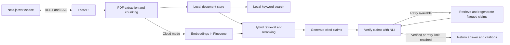

# Groundwork

**Ask questions about your PDFs and trace each answer back to the source.**

Groundwork is a document research workspace for self-correcting retrieval-augmented generation (RAG). Upload a PDF, wait for indexing, and query one document or the whole library. Open a citation to inspect the filename, page range, and supporting passage.

[Quickstart](#quickstart) · [Cloud verification](#cloud-verification) · [Architecture](#architecture) · [API](#api) · [Development](#development)

## Quickstart

Install Docker with the Compose plugin (v2.24 or later), then run:

```bash
git clone https://github.com/dhanushkumar-amk/SELF-CORRECTIVE-RAG.git
cd SELF-CORRECTIVE-RAG
docker compose up --build
```

Install and start Ollama on your computer, then make sure `ollama list` shows `qwen3:1.7b`. Compose connects to that host Ollama instance, so it uses your existing model without downloading another copy. The uploaded PDFs remain in a named Docker volume. To use another installed model, set `DEFAULT_LOCAL_MODEL` before starting Compose.

1. Open [Groundwork at localhost:3000](http://localhost:3000).
2. Choose **Try an example PDF** in the library and wait for **Ready**.
3. Choose **Find a specific detail** and send the budget question. The sample brief lists a pilot budget of **USD 48,000**.
4. Select a numbered citation to open the supporting text on page 1.

You can also upload a text-based PDF of your own. The default limit is 20 MB per file. Image-only scans require OCR before upload, and password-protected PDFs need to be unlocked first.

The [interactive API docs](http://localhost:8000/docs) run on port 8000. Use `docker compose down` to stop the services. The named data volume retains uploaded PDFs, indexed chunks, and downloaded cloud-mode models across restarts.

## Query modes

| | Local passage search | Cloud verification |
| --- | --- | --- |
| **Use it for** | Exploring PDFs without credentials | Generating cited answers and checking their claims against retrieved evidence |
| **Retrieval** | Keyword ranking over stored text | Pinecone dense search, BM25, reciprocal rank fusion, and cross-encoder reranking |
| **Result** | Generated cited answers from the self-hosted Ollama model | Generated claims with citations and verification status |
| **Requirements** | Ollama model download; no provider credentials | A Pinecone index and local embedding/reranking/verification models; answer generation uses the configured Ollama model by default and needs no cloud key |

Docker Compose starts in local retrieval mode and uses the self-hosted Ollama model for answer generation. In cloud mode, **Self-correction** controls corrective retries. The verification step still runs when retries are disabled.

## Cloud verification

1. Create a Pinecone dense index with **384 dimensions** and **cosine** similarity.
2. Copy [`backend/.env.example`](backend/.env.example) to `backend/.env`. Set your Pinecone key, index name, region, and at least one generation provider key.

   ```dotenv
   RAG_MODE=cloud
   REQUIRE_API_KEYS=true
   PINECONE_API_KEY=
   PINECONE_INDEX_NAME=self-correcting-rag
   PINECONE_ENVIRONMENT=us-east-1
   GROQ_API_KEY=
   GEMINI_API_KEY=
   ```

   Keep `backend/.env` out of version control. Groq is the default primary provider and Gemini is the fallback when configured.

3. For Docker Compose, set the mode in the launching shell as well:

   ```bash
   RAG_MODE=cloud docker compose up --build
   ```

   On PowerShell, run `$env:RAG_MODE = "cloud"` before `docker compose up --build`.

The first cloud ingestion or query may download embedding, reranking, or verification models. Reprocess PDFs indexed in local mode to populate Pinecone, or upload them again through the workspace.

### Configuration reference

| Variable | Default | Purpose |
| --- | --- | --- |
| `RAG_MODE` | `local` in Compose and the example file | Selects `local` or `cloud`. |
| `UPLOAD_DIR` | `uploads` locally, `/data/uploads` in Compose | Stores PDFs, extracted text, chunks, and the document registry. |
| `MAX_UPLOAD_SIZE_MB` | `20` | Maximum size of a single PDF. |
| `CORRECTION_MAX_RETRIES` | `2` | Maximum corrective passes per cloud query. |
| `NLI_CONFIDENCE_THRESHOLD` | `0.85` | Confidence required for an entailed claim to count as verified. |
| `RATE_LIMIT_QUERY_PER_MINUTE` | `10` | Query requests per client IP per minute when rate limiting is enabled. |
| `BACKEND_URL` | `http://127.0.0.1:8000` outside Compose | Server-side destination for the Next.js API proxy. |
| `NEXT_PUBLIC_API_URL` | Unset | Optional browser-facing API origin. Set backend `CORS_ORIGINS` to a JSON array of allowed frontend origins when using this override. |

## Architecture



Cloud mode uses natural language inference (NLI) to compare each generated claim with its cited passage. LangGraph routes flagged claims through targeted retrieval and partial regeneration. Verification estimates how well the retrieved text supports the claim. Source quality and retrieval coverage still matter.

| Directory | Contents |
| --- | --- |
| [`frontend/`](frontend/) | Next.js workspace, API client, and sample PDF |
| [`backend/app/api/`](backend/app/api/) | FastAPI routes and server-sent events |
| [`backend/app/ingestion/`](backend/app/ingestion/) | PDF extraction, chunking, and storage |
| [`backend/app/retrieval/`](backend/app/retrieval/) | Local passage search and hybrid retrieval |
| [`backend/app/graph/`](backend/app/graph/) | LangGraph correction workflow |
| [`backend/tests/`](backend/tests/) | Backend unit and integration tests |

## API

| Method | Endpoint | Purpose |
| --- | --- | --- |
| GET | `/health` | Check backend availability. |
| GET | `/api/v1/query/options` | Read the active mode and PDF size limit. |
| POST | `/api/v1/documents/upload` | Upload a PDF as multipart field `file`. |
| GET | `/api/v1/documents` | List documents and their indexing status. |
| POST | `/api/v1/documents/{id}/process` | Start background indexing. |
| GET | `/api/v1/documents/{id}/status` | Read indexing progress or a failure reason. |
| POST | `/api/v1/documents/{id}/retry` | Retry eligible failures. Pass `?sync=false` for background processing. |
| DELETE | `/api/v1/documents/{id}` | Remove a document and its indexed passages. |
| POST | `/api/v1/query` | Ask a question and receive SSE events or a JSON response. |

After indexing the example through the UI, try a JSON query:

```bash
curl -fsS http://localhost:8000/api/v1/query \
  -H 'Content-Type: application/json' \
  -d '{"query":"What is the pilot program budget?","stream":false}'
```

Supply `document_id` to scope a query to one PDF. For live progress, use `"stream":true` with `curl -N`. The stream ends with a `final_answer` or `error` event. Query rate-limit responses include a `Retry-After` header.

## Development

Use **Python 3.12** and **Node.js 22** to match CI.

**Backend** (from the repository root)

```bash
cd backend
python -m venv .venv
source .venv/bin/activate
python -m pip install -r requirements.txt
cp .env.example .env
python -m uvicorn app.main:app --reload --port 8000
```

On PowerShell, activate with `.venv\Scripts\Activate.ps1` and copy the configuration with `Copy-Item .env.example .env`.

**Frontend** (in a second terminal from the repository root)

```bash
cd frontend
npm ci
npm run dev
```

Open [localhost:3000](http://localhost:3000). The Next.js server proxies API requests to FastAPI. For a different backend port, copy [`frontend/.env.local.example`](frontend/.env.local.example) to `frontend/.env.local` and update `BACKEND_URL`.

### Tests and checks

From `backend/` with the virtual environment active:

```bash
RAG_MODE=cloud REQUIRE_API_KEYS=false ENVIRONMENT=test python -m pytest tests -q
```

The suite exercises both modes. Model-based tests can download Hugging Face models and tokenizer data on first run. Live provider tests require their corresponding credentials.

From `frontend/`:

```bash
npm run lint
npm run build
```

See the [contribution guide](CONTRIBUTING.md) and [GitHub Actions workflow](.github/workflows/ci.yml) for development conventions and CI.

## Deployment scope

The Compose setup binds to localhost and uses one backend process with a shared document library. A public or multi-user deployment requires access control and storage isolation.

## License

[MIT](LICENSE)
